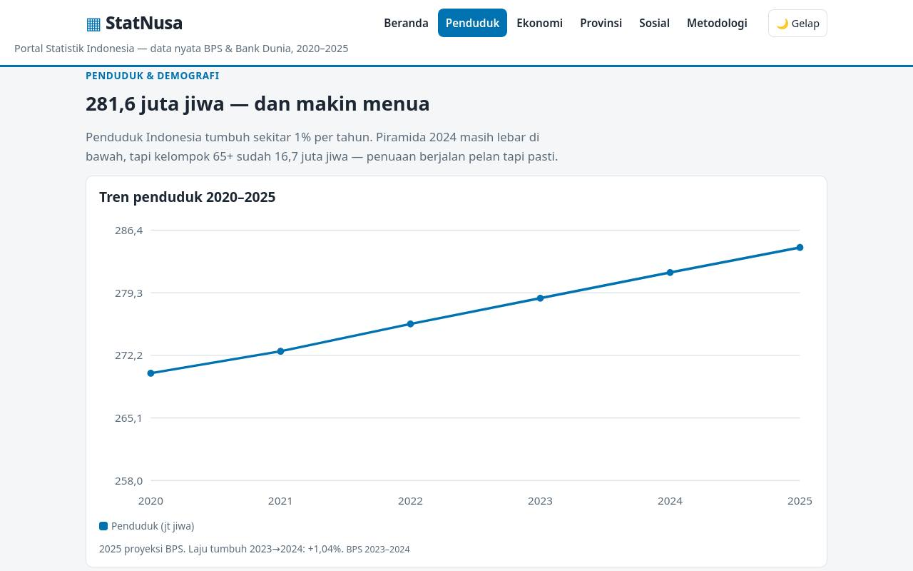
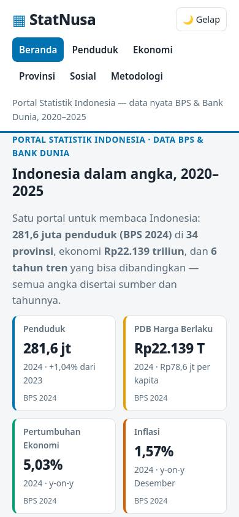

# StatNusa — Portal Statistik Indonesia (v2)

**Judul submit:** "StatNusa — Statistik Indonesia 2025: 281,6 Juta Penduduk, 34 Provinsi, 6 Tahun Tren dalam Satu Portal"

Portal statistik satu negara (Indonesia) dengan data nyata BPS & Bank Dunia, 2020–2025.
Sistem unik: **Komparator 34 Provinsi** — pilih 2–4 provinsi, bandingkan 6 indikator
(penduduk, PDRB per kapita, kemiskinan, pengangguran, IPM, inflasi) + tren kemiskinan 2020–2024.
**Baru di v2: Peta choropleth Indonesia interaktif** — 6 indikator, skala kuintil,
klik provinsi untuk menambahkannya ke Komparator.





## Section (semua via link, semua kontrol berfungsi)

1. **Beranda** — 6 KPI cards + grafik tren nasional dengan pemilih indikator.
2. **Penduduk & Demografi** — tren 2020–2025, piramida penduduk 2024, 10 provinsi terbesar.
3. **Ekonomi** — PDB per sektor, pertumbuhan per kuartal, ekspor vs impor + neraca.
4. **Provinsi** — peta choropleth interaktif + tabel 34 provinsi (sortable + pencarian) + Komparator multi-provinsi.
5. **Sosial** — kemiskinan, pengangguran, IPM, pendidikan, kota vs desa, provinsi ekstrem.
6. **Metodologi & Sumber** — sumber + tahun tiap angka, definisi, unduh CSV lokal.

## Teknologi

- `app/` statis, tanpa build step, tanpa network request (semua file lokal).
- Grafik digambar sendiri (SVG) di `app/charts.js`; peta di `app/map.js` (poligon
  provinsi disederhanakan dari garis pantai & batas provinsi, proyeksi equirectangular)
  — tanpa library chart/peta eksternal.
- Semua angka narasi dihitung dari `app/data.js` saat runtime (lihat `app/views.js`:
  `provPopTotal`, `top10Prov`, `javaShare`, `jabarVsSmallest`, `povertyCount`) — tidak
  ada angka narasi hardcoded. Dua angka penduduk dibedakan eksplisit: **281,6 jt**
  (total nasional BPS 2024) vs **283,87 jt** (jumlah 34 provinsi di data).
- Tema terang/gelap tersimpan lokal; responsif (desktop 1280×800 & phone 390×844).

## Jalankan

```sh
node serve.ts        # http://localhost:8080
node tools/verify.mjs   # serve + screenshot + cek link/kontrol/network/overflow
MAKEFUN_OUTPUT_DIR=out node main.ts   # tulis dossier.json
```

## Data

BPS (Statistik Indonesia 2025, BRS Pertumbuhan Ekonomi, Profil Kemiskinan, Keadaan
Ketenagakerjaan, IPM, Proyeksi Penduduk) dan Bank Dunia WDI. Berkas mentah:
`app/data/nasional.csv`, `app/data/provinsi.csv`, `app/data/ekonomi.csv`.
Struktur 34 provinsi mengikuti publikasi BPS 2024 agar deret 2020–2024 sebanding.

## Verifikasi (v2)

- `node tools/verify.mjs` — **40/40 PASS** (log lengkap: `tools/verify-v2.log`):
  6 rute + overflow desktop/phone, 0 request eksternal, 0 error, pemilih tren,
  cari/sort Komparator, sort tanpa scroll ke atas, peta 34 provinsi + legenda +
  ganti indikator + klik provinsi → Komparator, angka narasi = hitung data.js,
  4 screenshot ≤256 KiB.
- Tes grader 2× sebagai `nobody` (salinan /tmp, output milik root mode 777):
  exit 0 + dossier byte-identik — lihat build log v2.

## Known issues (v2)

- Poligon peta disederhanakan (4–8 titik per provinsi): batas antar-provinsi tidak
  presisi survei; bentuk kepulauan dipertahankan supaya terbaca sebagai Indonesia.
  DKI Jakarta digambar sedikit diperbesar agar bisa diklik.
- Peta memakai skala kuintil (tiap tingkat ±7 provinsi), bukan interval linear —
  dua provinsi dengan nilai berdekatan bisa beda warna bila melewati batas kuintil;
  legenda selalu menampilkan rentang tiap tingkat.
- Angka 2025 untuk penduduk adalah proyeksi; seri PDB, inflasi, TPT, dan IPM
  berakhir 2024 karena publikasi 2025 belum lengkap saat situs disusun.

## Changelog

- **v2** — peta choropleth Indonesia interaktif (klik → Komparator, 6 indikator,
  skala kuintil + legenda); SEMUA angka narasi dihitung dari data.js (perbaiki 4
  angka salah v1: total provinsi 283,87 jt; top-10 205,04 jt / 72,8%; klaim Jabar
  diganti "lebih besar dari 19 provinsi terkecil"; miskin 24,13 jt); cover beranda
  utuh (grafik + sumbu-x + legenda di atas lipatan; KPI 6 kolom); shot 2 dari atas
  (header/nav + peta utuh); shot 3 = Penduduk (piramida); sort tabel tanpa scroll
  ke atas; donat kota/desa diganti bar (bukan pangsa); keterangan ★ = terbaik per
  indikator; "tren 2020–2025" → "2020–2024" di Komparator; label sumbu-y grafik
  garis diperbaiki (dulu hanya 1 label terlihat).
- **v1** — build awal: 6 section, Komparator 34 Provinsi, grafik SVG tulisan sendiri,
  CSV lokal, tools/ verifikasi + screenshot Playwright Firefox.
