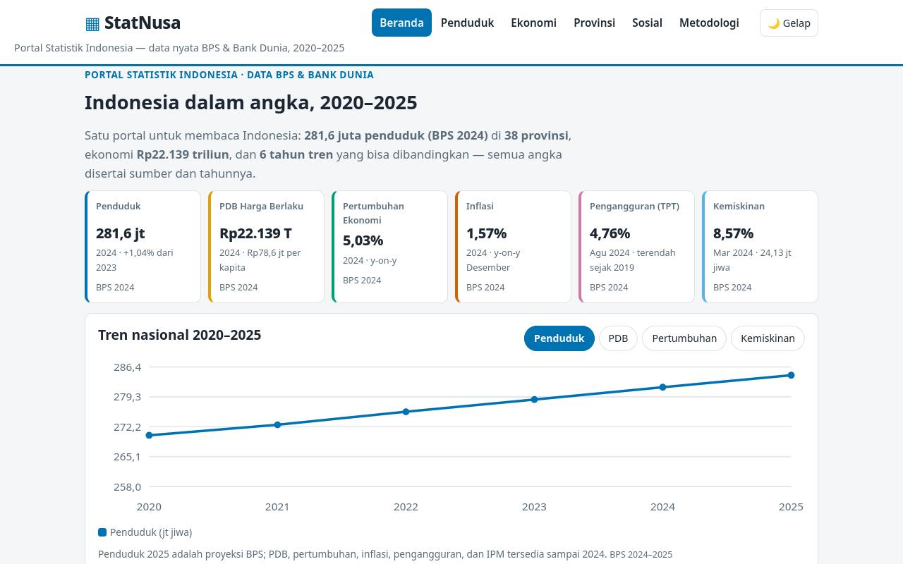
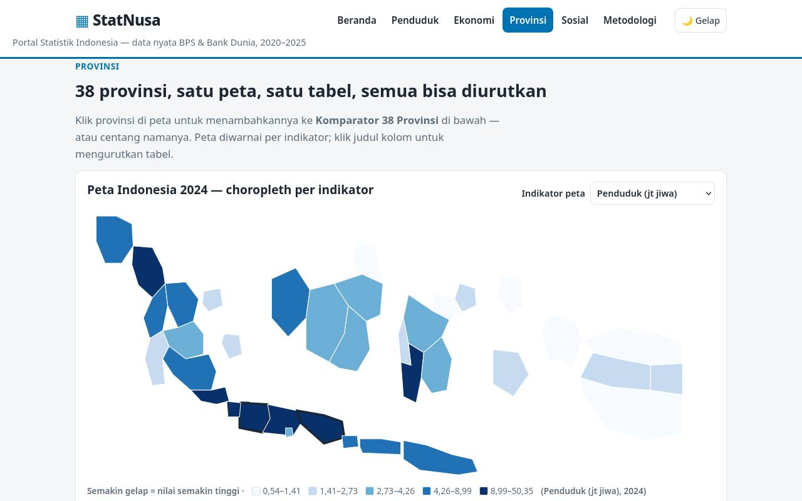

# StatNusa — Portal Statistik Indonesia (v2b)

**Judul submit:** "StatNusa — Statistik Indonesia 2025: 281,6 Juta Penduduk, 38 Provinsi, Peta + Komparator, 6 Tahun Tren"

Portal statistik satu negara (Indonesia) dengan data nyata BPS & Bank Dunia, 2020–2025.
Sistem unik: **Komparator 38 Provinsi** — pilih 2–4 provinsi, bandingkan 6 indikator
(penduduk, PDRB per kapita, kemiskinan, pengangguran, IPM, inflasi) + tren kemiskinan 2020–2024.
**Baru di v2: Peta choropleth Indonesia interaktif** — 6 indikator, skala kuintil,
klik provinsi untuk menambahkannya ke Komparator.
**Baru di v2b: 38 provinsi** — 4 provinsi pemekaran Papua 2022 (Papua Selatan,
Papua Tengah, Papua Pegunungan, Papua Barat Daya) + Papua Barat disesuaikan;
semua angka BPS 2024 pada batas wilayah baru.





## Section (semua via link, semua kontrol berfungsi)

1. **Beranda** — 6 KPI cards + grafik tren nasional dengan pemilih indikator.
2. **Penduduk & Demografi** — tren 2020–2025, piramida penduduk 2024, 10 provinsi terbesar.
3. **Ekonomi** — PDB per sektor, pertumbuhan per kuartal, ekspor vs impor + neraca.
4. **Provinsi** — peta choropleth interaktif + tabel 38 provinsi (sortable + pencarian) + Komparator multi-provinsi.
5. **Sosial** — kemiskinan, pengangguran, IPM, pendidikan, kota vs desa, provinsi ekstrem.
6. **Metodologi & Sumber** — sumber + tahun tiap angka, definisi, unduh CSV lokal.

## Teknologi

- `app/` statis, tanpa build step, tanpa network request (semua file lokal).
- Grafik digambar sendiri (SVG) di `app/charts.js`; peta di `app/map.js` (poligon
  provinsi disederhanakan dari garis pantai & batas provinsi, proyeksi equirectangular)
  — tanpa library chart/peta eksternal.
- Semua angka narasi dihitung dari `app/data.js` saat runtime (lihat `app/views.js`:
  `provPopTotal`, `top10Prov`, `javaShare`, `jabarVsSmallest`, `povertyCount`) — tidak
  ada angka narasi hardcoded. Dua angka penduduk dibedakan eksplisit: **281,6 jt**
  (total nasional BPS 2024) vs **283,88 jt** (jumlah 38 provinsi di data).
- Tema terang/gelap tersimpan lokal; responsif (desktop 1280×800 & phone 390×844).

## Jalankan

```sh
node serve.ts        # http://localhost:8080
node tools/verify.mjs   # serve + screenshot + cek link/kontrol/network/overflow
MAKEFUN_OUTPUT_DIR=out node main.ts   # tulis dossier.json
```

## Data

BPS (Statistik Indonesia 2025, BRS Pertumbuhan Ekonomi, Profil Kemiskinan, Keadaan
Ketenagakerjaan, IPM, Proyeksi Penduduk) dan Bank Dunia WDI. Berkas mentah:
`app/data/nasional.csv`, `app/data/provinsi.csv`, `app/data/ekonomi.csv`.
Struktur 38 provinsi mengikuti pemekaran Papua 2022 (UU No. 14–16/2022, UU No. 29/2022).
Sumber 6 provinsi Papua (2024, BPS): penduduk — proyeksi interim pertengahan 2024;
PDRB per kapita — [Seri 2010] PDRB Per Kapita 2024; kemiskinan — Susenas Maret 2024
(Data dan Informasi Kemiskinan Kabupaten/Kota 2024); TPT — Sakernas Agustus 2024;
IPM — BRS No. 85/11/Th. XXVII, 15 Nov 2024; inflasi — BRS IHK Desember 2024
(No. 01/01/Th. XXVIII, 2 Jan 2025).

## Verifikasi (v2b)

- `node tools/verify.mjs` — **51/51 PASS** (log lengkap: `tools/verify-v2b.log`):
  6 rute + overflow desktop/phone, 0 request eksternal, 0 error, pemilih tren,
  cari/sort Komparator, sort tanpa scroll ke atas, peta 38 provinsi + legenda +
  ganti indikator + klik provinsi → Komparator (termasuk klik Papua Tengah),
  n/a kemiskinan 2020 di Komparator, assert kualitas data 6 dimensi
  (completeness/uniqueness/validity/consistency/accuracy/freshness; CSV ==
  data.js; peta == data), angka narasi = hitung data.js, 4 screenshot ≤256 KiB.
- Tes grader 2× sebagai `nobody` (salinan /tmp, output milik root mode 777):
  exit 0 + dossier byte-identik — lihat build log v2b.

## Known issues (v2b)

- Poligon peta disederhanakan (4–8 titik per provinsi): batas antar-provinsi tidak
  presisi survei; bentuk kepulauan dipertahankan supaya terbaca sebagai Indonesia.
  DKI Jakarta digambar sedikit diperbesar agar bisa diklik.
- Peta memakai skala kuintil (tiap tingkat ±8 provinsi), bukan interval linear —
  dua provinsi dengan nilai berdekatan bisa beda warna bila melewati batas kuintil;
  legenda selalu menampilkan rentang tiap tingkat.
- Angka 2025 untuk penduduk adalah proyeksi; seri PDB, inflasi, TPT, dan IPM
  berakhir 2024 karena publikasi 2025 belum lengkap saat situs disusun.
- **Batas shot 4 vs cakupan 6 section (konflik aturan, didokumentasikan):** aturan
  kompetisi membatasi `screenshots/` ke 3–4 gambar, jadi hanya 4 rute yang bisa
  difoto sebagai shot submit (Beranda, Provinsi+peta, Penduduk, Beranda phone).
  Ekonomi, Sosial, dan Metodologi tetap diverifikasi lewat cek rute/kontrol di
  `tools/verify.mjs` + screenshot sementara di /tmp saat build, bukan sebagai shot.
- **Vintage split (diketahui, bukan disembunyikan):** angka PDRB per kapita, IPM,
  dan inflasi 32 provinsi lainnya masih memakai vintage v1 (seri lama, efektif
  2023); hanya 6 provinsi Papua yang memakai rilis BPS 2024. Pemanenan ulang
  32 provinsi ke satu vintage adalah pekerjaan lanjutan — lihat Metodologi.
- **Kemiskinan 2020 n/a untuk 6 provinsi Papua:** BPS tidak menerbitkan deret
  2020 pada batas wilayah baru hasil pemekaran 2022; Komparator menampilkan
  "n/a (belum diterbitkan BPS)" untuk sel 2020 & perubahan provinsi tersebut.

## Changelog

- **v2b** — 38 provinsi: 4 provinsi pemekaran Papua 2022 ditambah (Papua Selatan,
  Papua Tengah, Papua Pegunungan, Papua Barat Daya) + Papua Barat disesuaikan,
  semua angka BPS 2024 (penduduk proyeksi interim; PDRB per kapita; kemiskinan
  Susenas Mar 2024; TPT Sakernas Agu 2024; IPM BRS Nov 2024; inflasi BRS IHK
  Jan 2025); peta dipecah jadi 6 poligon Papua dengan batas berbagi titik;
  skala kuintil digeneralisasi ke n (batas dari jumlah provinsi, bukan angka
  mati); angka narasi dihitung ulang dari 38 provinsi (Σ 283,88 jt; klaim Jabar
  "23 provinsi terkecil (50,19 jt)"; ekstrem baru Papua Pegunungan: miskin
  32,97%, IPM 54,43, TPT 1,32%); kemiskinan 2020 = n/a untuk 6 provinsi Papua;
  assert kualitas data di verify (completeness/uniqueness/validity/consistency/
  accuracy/freshness; CSV == data.js; peta == data).
- **v2** — peta choropleth Indonesia interaktif (klik → Komparator, 6 indikator,
  skala kuintil + legenda); SEMUA angka narasi dihitung dari data.js (perbaiki 4
  angka salah v1: total provinsi 283,87 jt; top-10 205,04 jt / 72,8%; klaim Jabar
  diganti "lebih besar dari 19 provinsi terkecil"; miskin 24,13 jt); cover beranda
  utuh (grafik + sumbu-x + legenda di atas lipatan; KPI 6 kolom); shot 2 dari atas
  (header/nav + peta utuh); shot 3 = Penduduk (piramida); sort tabel tanpa scroll
  ke atas; donat kota/desa diganti bar (bukan pangsa); keterangan ★ = terbaik per
  indikator; "tren 2020–2025" → "2020–2024" di Komparator; label sumbu-y grafik
  garis diperbaiki (dulu hanya 1 label terlihat).
- **v1** — build awal: 6 section, Komparator 34 Provinsi, grafik SVG tulisan sendiri,
  CSV lokal, tools/ verifikasi + screenshot Playwright Firefox.
